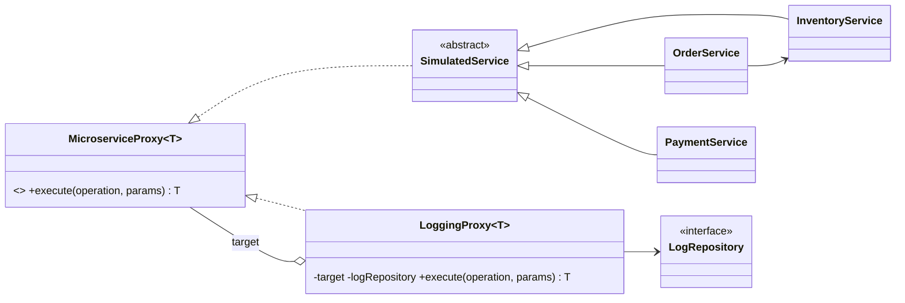

# Backend: Monitoreo de microservicios con Proxy de logging

API Spring Boot (Java 17, Maven) del taller de **Patrones de Software** sobre el patrón **Proxy**.
Inventario, Pedidos y Pagos son servicios reales en memoria; un `LoggingProxy<T>` genérico los envuelve, mide cada llamada y registra éxitos y errores (con stack trace resumido).

Documentación completa (diagrama de clases Mermaid, contrato de la API, checklist del enunciado y despliegue paso a paso): ver el [README principal del monorepo](https://github.com/MarioZaMu/TallerProxyFrontend#readme) o el archivo `README.md` en la raíz del proyecto.

## Diseño



Paquetes: `proxy`, `service`, `model`, `repository`, `controller`, `config`, `exception`, `dto`, `util`.

## Ejecutar

```bash
./mvnw clean verify          # 35 tests
java -jar target/app.jar     # http://localhost:8080
```

## Endpoints

| Método | Ruta | Descripción |
|---|---|---|
| POST | `/api/services/inventory/{operation}` | `listProducts`, `checkStock`, `addStock`, `removeStock` |
| POST | `/api/services/orders/{operation}` | `createOrder`, `getOrder`, `listOrders`, `cancelOrder` |
| POST | `/api/services/payments/{operation}` | `processPayment`, `getPaymentStatus`, `refundPayment` (10% falla a propósito) |
| GET | `/api/metrics/summary` | Total de llamadas, tasa de éxito/error y tiempo promedio por servicio |
| GET | `/api/metrics/logs?service=&status=&from=&to=&page=&size=` | Logs filtrados y paginados |
| POST | `/api/metrics/simulate-load` | Genera 50 llamadas aleatorias |
| GET | `/actuator/health` | Health check |

Ejemplo:

```bash
curl -X POST localhost:8080/api/services/inventory/checkStock \
  -H 'Content-Type: application/json' -d '{"sku":"SKU-1001","quantity":2}'
```

## Variables de entorno

| Variable | Por defecto | Descripción |
|---|---|---|
| `PORT` | `8080` | Puerto HTTP |
| `ALLOWED_ORIGINS` | localhost de desarrollo y `https://*.vercel.app` | Orígenes CORS separados por coma |
| `PAYMENT_FAILURE_RATE` | `0.10` | Probabilidad de fallo intencional en Pagos |
| `MIN_LATENCY_MS` / `MAX_LATENCY_MS` | `30` / `400` | Latencia simulada |
| `LOG_MAX_ENTRIES` | `5000` | Máximo de logs en memoria |

## Despliegue en Railway

1. **New Project -> Deploy from GitHub repo** y elige este repositorio (usa el `Dockerfile` y `railway.json`).
2. **Settings -> Networking -> Generate Domain** y copia la URL.
3. En **Variables** agrega `ALLOWED_ORIGINS` con la URL del frontend en Vercel.
4. Verifica `https://<tu-dominio>/actuator/health`.
