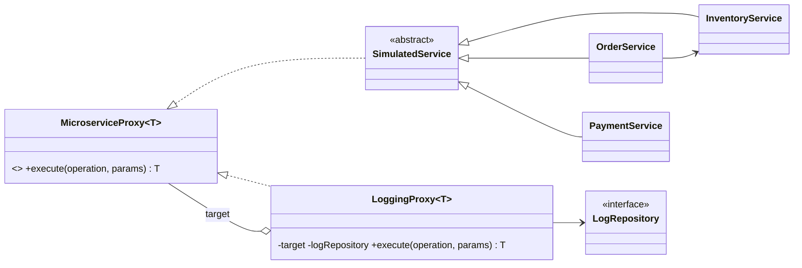

# Backend: Monitoreo de microservicios con Proxy de logging

API Spring Boot (Java 17, Maven) del taller de **Patrones de Software** sobre el patrón **Proxy**.
Inventario, Pedidos y Pagos son servicios reales en memoria; un `LoggingProxy<T>` genérico los envuelve, mide cada llamada y registra éxitos y errores (con stack trace resumido).

## Diseño



Paquetes: `proxy`, `service`, `model`, `repository`, `controller`, `config`, `exception`, `dto`, `util`.

Cada llamada: `ServiceController -> ProxyRegistry -> LoggingProxy -> servicio real`. El proxy genera un `requestId` (UUID), mide la duración con `System.nanoTime()`, guarda un `LogEntry` (éxito o error con stack trace resumido) y relanza la excepción para que el controller devuelva el código HTTP correcto.

## Ejecutar

```bash
./mvnw clean verify          # 35 tests
java -jar target/app.jar     # http://localhost:8080
```

## Endpoints

| Método | Ruta | Descripción |
|---|---|---|
| POST | `/api/services/inventory/{operation}` | `listProducts`, `checkStock`, `addStock`, `removeStock` |
| POST | `/api/services/orders/{operation}` | `createOrder`, `getOrder`, `listOrders`, `cancelOrder` |
| POST | `/api/services/payments/{operation}` | `processPayment`, `getPaymentStatus`, `refundPayment` (10% falla a propósito) |
| GET | `/api/metrics/summary` | Total de llamadas, tasa de éxito/error (%) y tiempo promedio por servicio |
| GET | `/api/metrics/logs?service=&status=&from=&to=&page=&size=` | Logs filtrados y paginados (más nuevos primero) |
| POST | `/api/metrics/simulate-load` | Genera 50 llamadas aleatorias |
| GET | `/actuator/health` | Health check |

### Cuerpos de las operaciones

| Servicio | Operación | Body |
|---|---|---|
| inventory | `listProducts` | `{}` |
| inventory | `checkStock` | `{"sku":"SKU-1001","quantity":2}` (`quantity` opcional) |
| inventory | `addStock` / `removeStock` | `{"sku":"SKU-1002","quantity":10}` (`409` si no hay stock suficiente) |
| orders | `createOrder` | `{"customerId":"C-1","items":[{"sku":"SKU-1002","quantity":2}]}` |
| orders | `getOrder` / `cancelOrder` | `{"orderId":"ORD-1001"}` |
| orders | `listOrders` | `{}` o `{"status":"CANCELLED"}` |
| payments | `processPayment` | `{"orderId":"ORD-1001","amount":178000,"method":"CARD"}` (`CARD`, `PSE`, `TRANSFER`, `CASH`) |
| payments | `getPaymentStatus` / `refundPayment` | `{"paymentId":"PAY-5001"}` |

Respuesta de los servicios: `{"requestId","serviceId","operation","result"}`. Errores: `{"timestamp","status","error","message","requestId"}` con `400`, `404`, `409`, `502` (fallo de pagos) o `500`.

Ejemplo:

```bash
curl -X POST localhost:8080/api/services/inventory/checkStock \
  -H 'Content-Type: application/json' -d '{"sku":"SKU-1001","quantity":2}'
```

Parámetros de `/api/metrics/logs` (todos opcionales): `service`, `status` (`SUCCESS|ERROR`), `from` y `to` (instante ISO-8601 o fecha `2026-10-30`), `page` (0), `size` (20, máx. 200). Respuesta: `content`, `page`, `size`, `totalElements`, `totalPages`.

## Variables de entorno

| Variable | Por defecto | Descripción |
|---|---|---|
| `PORT` | `8080` | Puerto HTTP |
| `ALLOWED_ORIGINS` | localhost de desarrollo y `https://*.vercel.app` | Orígenes CORS separados por coma |
| `PAYMENT_FAILURE_RATE` | `0.10` | Probabilidad de fallo intencional en Pagos |
| `MIN_LATENCY_MS` / `MAX_LATENCY_MS` | `30` / `400` | Latencia simulada |
| `LOG_MAX_ENTRIES` | `5000` | Máximo de logs en memoria |

## Despliegue en Railway

1. **New Project -> Deploy from GitHub repo** y elige este repositorio (usa el `Dockerfile` y `railway.json`).
2. **Settings -> Networking -> Generate Domain** y copia la URL.
3. En **Variables** agrega `ALLOWED_ORIGINS` con la URL del frontend en Vercel.
4. Verifica `https://<tu-dominio>/actuator/health`.
